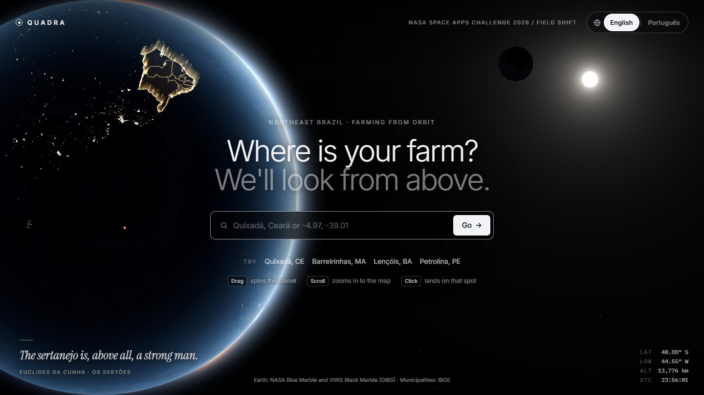
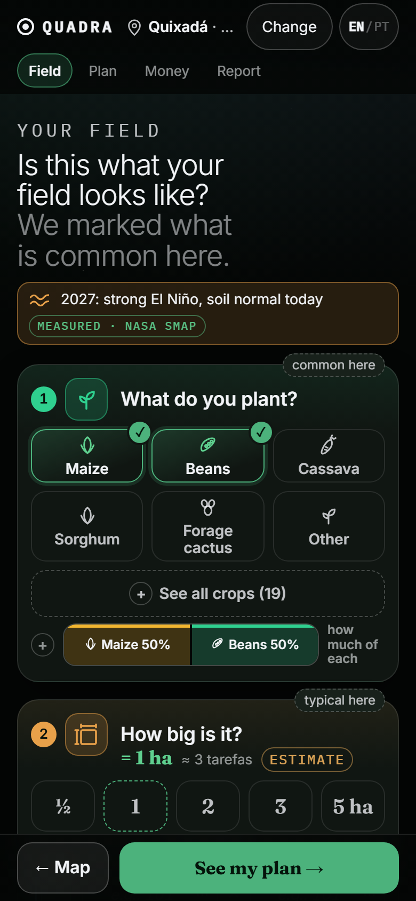
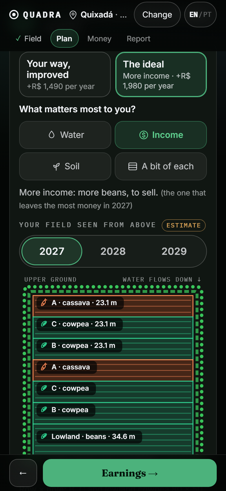
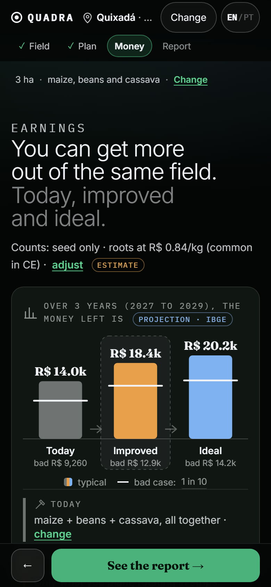
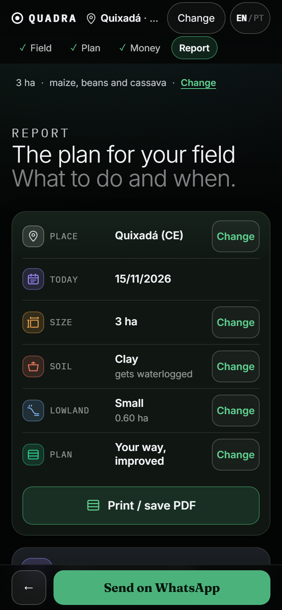
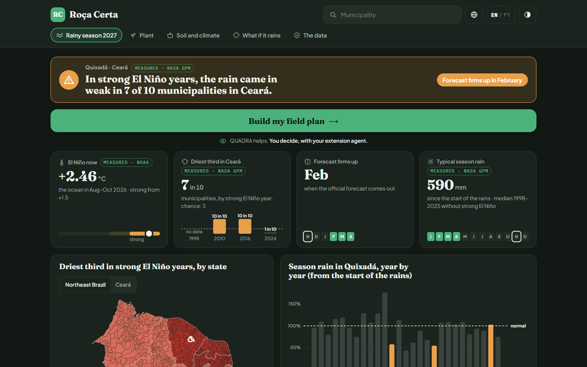

<h1 align="center">QUADRA</h1>

<p align="center">
  <b>Science-backed crop rotation for smallholder farmers, powered by NASA data</b><br>
  NASA Space Apps Challenge 2026 · Field Shift: Adapting Farms with NASA Data
</p>

<p align="center">
  
</p>

QUADRA is a partner for the smallholder farmer of Brazil's semi-arid Northeast. It starts from what the farmer plants today,
improves it, and recommends what would be ideal for that land, based on NASA data and on what science has shown to work.
"Quadra" is what the people of the sertão call the rainy season.

- **Science first.** About 100 papers and technical manuals became a catalogue of 147 rotation configurations, each graded by
  strength of evidence and by how well it transfers to the semi-arid. A number appears only when it was measured in a comparable climate.
- **El Niño in the plan.** Each municipality shows how its rain behaved in the strong El Niño years, as another is expected in 2026/27.
- **No pesticides, no monoculture.** Rotation, legumes and alternating strips break pest and disease cycles and feed the soil.
- **Made for the farmer.** Plain words, pictures, the plot measured in metres, on a phone, in English or Portuguese.

## The farmer's journey

<table>
  <tr>
    <td width="25%"></td>
    <td width="25%"></td>
    <td width="25%"></td>
    <td width="25%"></td>
  </tr>
  <tr>
    <td align="center"><b>1. Your field</b><br>six questions with pictures</td>
    <td align="center"><b>2. The plan</b><br>the plot in strips, today's way against the ideal</td>
    <td align="center"><b>3. Earnings</b><br>income against today's practice</td>
    <td align="center"><b>4. Report</b><br>what to do and when, ready to print</td>
  </tr>
</table>

Before the journey, the farmer finds the municipality on the globe (all 1,794 of the Northeast) and can open its panel, with
the rain, the soil moisture and the El Niño history:

<p align="center">
  
</p>

## Run it

You need Python 3.13 (the version we tested) and an internet connection for the map tiles.

```bash
git clone https://github.com/Netinhoklz/competicao-nasa.git
cd competicao-nasa
python -m venv venv
venv\Scripts\activate            # macOS or Linux: source venv/bin/activate
pip install -r requirements.txt
python app.py
```

`app.py` is the start. When the line `QUADRA (site final) em http://localhost:8090` appears, open that address in the browser.
The repository already brings the data the engine reads (`dados/`, about 75 MB), so nothing else has to be downloaded.

- `http://localhost:8090` opens the globe; `http://localhost:8090/roca.html#/2311306/2` goes straight to the journey in Quixadá (CE).
- The site opens in English. The switch to Portuguese is on the home page and at the top of the other pages.
- Another port: `python app.py 8091`.

## How it works

```
browser  (site-versao-final/web: HTML, CSS and JavaScript, no framework)
   |  the plan, the income and the report are computed in the browser from the farmer's answers,
   |  which stay in the page address: there is no login and no database
   v
server   (site-versao-final/servidor.py: Python standard library)
   v
engine   (site-versao-final/nucleo/motor.py)
   reads dados/ (NASA POWER, GPM IMERG, SMAP, ZARC, GAEZ, IBGE) and pesquisa/catalogo_rotacoes.json
```

1. **Which crops fit here.** Brazil's official climate-risk zoning (ZARC 2026/27) decides where it exists; elsewhere, the
   FAO GAEZ v4 suitability.
2. **The climate of the place.** Rain, temperature and the start of the rainy season from NASA POWER and GPM IMERG; soil
   moisture now, against the same time in other years, from SMAP.
3. **The rotation.** Rules from the evidence catalogue, never a monoculture, in alternating strips so that plants of the same
   family do not form a continuous path for pests and diseases (an idea borrowed from percolation theory).
4. **The money.** Expected income of the plan against today's practice, with official yields (IBGE) and costs (CONAB).

## NASA data

| Resource | Where it is used |
|---|---|
| [NASA POWER](https://power.larc.nasa.gov/) | climate of each municipality and climate analogues |
| [GPM IMERG V07](https://gpm.nasa.gov/data/imerg) | rain, start of the rainy season and the strong El Niño years |
| [SMAP L4 soil moisture](https://nsidc.org/data/spl4smgp) | how wet the soil is now, against other years |
| [MODIS](https://www.earthdata.nasa.gov/data/instruments/modis) and [VIIRS](https://www.earthdata.nasa.gov/data/catalog/lpcloud-vnp13a3-002) vegetation indices | how green the municipality is, year by year |
| [GRACE and GRACE-FO](https://grace.jpl.nasa.gov/) | stored water, by region |
| [NASADEM](https://www.earthdata.nasa.gov/data/catalog/lpcloud-nasadem-hgt-001) | slope of the land |
| [Blue Marble](https://science.nasa.gov/earth/earth-observatory/collections/blue-marble/) and [VIIRS Black Marble](https://blackmarble.gsfc.nasa.gov/), through [GIBS](https://nasa-gibs.github.io/gibs-api-docs/) | the Earth on the home page |
| SMAP L3, [GLDAS](https://ldas.gsfc.nasa.gov/gldas), [NLDAS](https://ldas.gsfc.nasa.gov/nldas), Landsat, [FIRMS](https://firms.modaps.eosdis.nasa.gov/) and NEX-GDDP-CMIP6 | the studies in `notebooks/` |

Other sources: NOAA/CPC (ONI), FAO/IIASA GAEZ v4, MAPA ZARC 2026/27, IBGE, CONAB and OpenStreetMap. The full list, with licences,
is in [`site-versao-final/CREDITOS.md`](site-versao-final/CREDITOS.md).

## The science behind it

- Every rotation rule has two grades: strength of evidence (A to D) and transfer to the semi-arid (T0 to T3). The engine uses a
  number only when it was measured in the Brazilian semi-arid or in a comparable climate; otherwise it shows only the direction.
- The catalogue is in [`pesquisa/catalogo_rotacoes_comprovadas.md`](pesquisa/catalogo_rotacoes_comprovadas.md), with the source
  of each card. Some of the references behind the project:
  - Mudare et al. (2025), *Crop rotations synergize yield, nutrition, and revenue: a meta-analysis*, Nature Communications. [doi](https://doi.org/10.1038/s41467-025-64567-9)
  - Zhao et al. (2022), *Global systematic review with meta-analysis reveals yield advantage of legume-based rotations and its drivers*, Nature Communications. [doi](https://doi.org/10.1038/s41467-022-32464-0)
  - Kluger, Di Tommaso and Lobell (2025), *Precrop payoffs: causal machine learning reveals large but variable yield benefits of crop rotation in major breadbaskets*, Environmental Research Letters. [doi](https://doi.org/10.1088/1748-9326/ae0f45)
  - Alonso-Tlali et al. (2025), Entropy 27(4):386, for the percolation threshold behind the strips.
  - Fischer et al. (2021), *Global Agro-Ecological Zones v4: model documentation*, FAO.

## What is in the repository

| Folder | Content |
|---|---|
| `app.py`, `requirements.txt` | the start and the packages |
| `site-versao-final/` | the product: the site (`web/`), the engine (`nucleo/`), the server, the tests and the analyses |
| `dados/` | the data the engine reads when it runs |
| `pesquisa/` | the literature review and the catalogue of rotations |
| `notebooks/`, `scripts/` | the studies of each data source and the scripts that download and prepare the data |
| `proposta/`, `conselho/` | the proposal and the analyses that led to it |
| `protótipo/`, `site-nasa/` | earlier versions, kept for the record |

## Team

- **José** ([Netinhoklz](https://github.com/Netinhoklz)): the data engine, the rotation rules and the farmer's journey.
- **João Pedro** (JpLimags): the 3D globe, the map and the municipality panel.
- **Vicente Lima**: the strips, from percolation theory.

## AI use (uso de IA)

The NASA Space Apps rules ask each team to say where and how AI tools were used. In this project:

- **Tool.** Claude (Anthropic), mostly through Claude Code, used by the three team members.
- **Code.** The site in `site-versao-final/` (HTML, CSS and JavaScript), the Python engine (`site-versao-final/nucleo/motor.py`),
  the server, the data-preparation scripts (`scripts/`, `site-versao-final/ferramentas/`), the notebooks and the tests were
  written with Claude under the team's direction. The team chose what to build, tested the site and decided what stayed.
- **Data produced with AI.**
  - `site-versao-final/web/i18n/en.json`: the English text of the site, translated from the Portuguese source.
  - `pesquisa/catalogo_rotacoes.json` and `pesquisa/catalogo_rotacoes_comprovadas.md`: the 147 evidence cards were extracted
    from the papers by AI agents, and the numbers were checked against each paper's text or source data (`conselho/analises/`).
  - Both JSON files carry this statement in a metadata field (`_meta.ai_disclosure` and `uso_de_ia`).
- **Text.** The analyses, the proposal and the literature notes in `proposta/`, `conselho/`, `pesquisa/` and
  `site-versao-final/analise/` were drafted with Claude. Where these documents say "council", "specialists" or "agents"
  ("conselho", "especialistas", "agentes"), they mean panels of AI agents, not human experts.
- **Images.** No AI image generator was used. The icons, the drawings of the plot and the satellites on the globe are vector
  and 3D shapes drawn by the site's code. The Earth and Moon textures are real imagery: NASA Blue Marble and VIIRS Black
  Marble (GIBS), and Solar System Scope (CC BY 4.0).
- **Audio and video.** None is AI-generated. The demo was made by the team, without AI.
- **Not AI-generated.** The measured data: NASA (POWER, GPM IMERG, SMAP), NOAA, FAO GAEZ, MAPA ZARC, IBGE and CONAB.
- **NASA branding.** The project uses no NASA logo, flag or mission identifier. NASA is named only as a data source.

In the site, this statement lives in the code, not on screen: each page carries it in a `<meta name="ai-disclosure">` tag,
next to a comment that points to this section.

---

## Em português

O QUADRA é um parceiro do pequeno agricultor do semiárido nordestino: parte do que ele planta hoje, melhora isso e recomenda o
que seria o ideal para aquela terra, com base nos dados da NASA e no que a ciência mostrou que funciona.

**Como rodar.** Com o Python 3.13, rode os comandos de "Run it" (clonar, criar o ambiente, `pip install -r requirements.txt` e
`python app.py`) e abra http://localhost:8090. O repositório já traz em `dados/` os cerca de 75 MB que o motor lê. O site abre
em inglês; a troca para português fica na página inicial e no topo das outras páginas.

**Onde está cada coisa.** O produto é a pasta `site-versao-final/` (documentação em português no
[`README.md`](site-versao-final/README.md) dela e as decisões em `PLANO_INTEGRACAO.md`). Os estudos de cada base de dados estão em
`notebooks/` (fonte em `notebooks/secoes/`, montagem por `scripts/montar_notebook.py`), a revisão de literatura e o catálogo de
rotações em `pesquisa/`, e a proposta em `proposta/` (o "conselho" que aparece nesses documentos é um painel de agentes de IA).

**Dados brutos.** Os cerca de 11 GB de dados brutos (mais 7 GB do CDL) não estão no repositório. Eles podem ser recriados com os
scripts `scripts/baixar_*.py`, e os manifestos em `dados_resumo/manifestos/` dizem de onde veio cada arquivo. SMAP, VIIRS NDVI,
GLDAS, NLDAS e o IMERG V07 recente exigem conta NASA Earthdata; as credenciais ficam no `_netrc` do usuário e nunca entram no
repositório.

**Uso de IA.** O código, a tradução para o inglês, os desenhos feitos por código, o resumo dos artigos e os textos de análise
foram feitos com ajuda de IA (Claude, da Anthropic), sob a direção da equipe. Os dados medidos e as imagens de satélite são
reais, não gerados por IA. Nenhuma imagem, áudio ou vídeo foi gerado por IA, e o projeto não usa marca da NASA.
